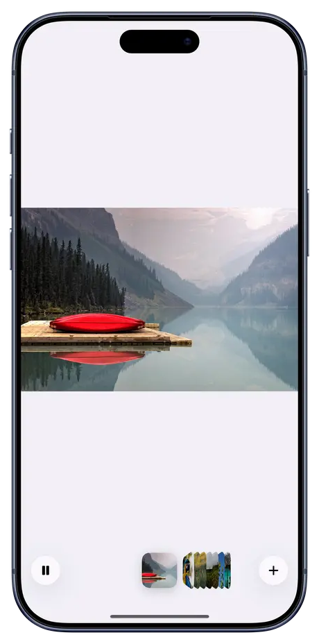

<p align="center">
  
</p>

<h1 align="center">LiquidPhotos</h1>

<p align="center">
  Photos that flow into each other, for SwiftUI.<br />
  Every pixel travels to its place in the next photo, and a shelf of photos flips each one out to meet you.
</p>

<p align="center">
  
  
  
  
  
</p>

<p align="center">
  <a href="https://buymeacoffee.com/jcbuilds"></a>
  <br>
  <sub>If LiquidPhotos is useful to you, a coffee keeps it going.</sub>
</p>

---

```swift
LiquidAlbum($photos)
```

That is the whole integration. You get the stage, a shelf of your photos stacked edge-on like CDs, play and pause, and a **+** that opens the photo picker. Photos of the same scene line up and the camera glides from one view to the other, so a closer shot plays like walking up to it and the same scene a moment later plays like it moving. Photos with nothing in common still flow into each other in place. It all runs on the device in one Metal pass, with no generative model and no network.

**[Download the demo video (MP4)](assets/demo.mp4)**

## Installation

In Xcode: **File > Add Package Dependencies** and paste

```
https://github.com/haplollc/LiquidPhotos
```

Or in `Package.swift`:

```swift
dependencies: [
    .package(url: "https://github.com/haplollc/LiquidPhotos", from: "1.0.0")
]
```

Then add `LiquidPhotos` to your target's dependencies. For 120 Hz on ProMotion iPhones, set `CADisableMinimumFrameDurationOnPhone` to `YES` in your Info.plist.

## Quick start

```swift
import SwiftUI
import LiquidPhotos

struct Album: View {
    @State private var photos: [UIImage] = []

    var body: some View {
        LiquidAlbum($photos)
    }
}
```

Tap **+**, pick some photos, press play. Photos you add are appended to `photos`, so you can save them, and anything you put in `photos` yourself shows up on the shelf.

## Three pieces

Use the album as is, or take it apart.

| | View | What it is |
|---|---|---|
| 📚 | **`LiquidAlbum`** | The whole thing: stage, shelf, play and **+**. One line. |
| 🌊 | **`LiquidPhotos`** | Just the stage. It shows one photo at a time and flows into whichever you select. |
| 💿 | **`LiquidPhotoStrip`** | Just the shelf. The selected photo faces you, the rest stand edge-on, and choosing another flips it out in 3D. Tap or drag it. |

<p align="center">
  
</p>

Build your own controls around the stage and the shelf:

```swift
struct Slideshow: View {
    let photos: [UIImage]
    @State private var index = 0
    @State private var playing = false

    var body: some View {
        VStack {
            LiquidPhotos(photos, selection: $index, isPlaying: $playing)
            LiquidPhotoStrip(photos, selection: $index) {
                Button(playing ? "Pause" : "Play") { playing.toggle() }
            }
        }
    }
}
```

Changing `selection` flows to that photo. While `isPlaying` is true, the stage holds each photo and then moves on; at the end it loops, or stops and sets `isPlaying` back to false. The shelf's trailing view, here the play button, is pinned to its right edge.

## Style

```swift
LiquidAlbum($photos, style: LiquidPhotosStyle(
    transitionDuration: 1.5,   // seconds per transition
    holdDuration: 1.8,         // seconds each photo holds while playing
    loops: true,
    morph: 1,                  // how far pixels travel (0 cross-fades in place)
    cornerRadius: 0
), startsPlaying: true)
```

`LiquidAlbum` also takes `allowsAdding: false` to hide the **+** when the photos come from your app.

## How it works

- **Alignment.** For each pair it searches for where one photo sits inside the other: a scaled, shifted window, both ways round, coarse to fine. The score is colour correlation, and the pair counts as the same scene above 0.7. A close-up becomes a small window of the wide shot, and a step aside becomes a shifted one.
- **Camera.** The frame shows a quad of the first photo's world, and a transition moves it from the first photo's view to the second's. Position is eased with smootherstep and size is interpolated logarithmically, so the approach feels steady. The frame reshapes to the new photo along the way.
- **Everything moves.** A dense optical flow proposes where every part of the picture went. Each proposal is polished by a small patch search, and the more alike its 7×7 patches look in both photos, the harder it pulls. Near-identical photos move precisely, and very different ones still flow into each other.
- **Solid pieces, not swirls.** A 32-column mesh is fitted to all those pulls with the content-preserving warp of Liu, Gleicher, Jin & Agarwala (2009), the method behind After Effects' Warp Stabilizer: every triangle resists changing shape. The fit is reweighted so a few bad proposals can't bend a region, and Accelerate's sparse Cholesky solves it in milliseconds.
- **Re-tinting.** Each vertex carries the local colour shift between the photos, so the same thing in different light changes its look as it moves instead of dissolving.
- **Fallback.** Where moved, re-tinted pixels still disagree (something genuinely appears or leaves), that spot cross-fades slowly instead of being pulled around, the idea behind After Effects' Timewarp error threshold. Both ideas came from studying [EffectCraft](https://github.com/storytold/effectcraft)'s clean-room reimplementations; no code was copied.
- **Frame rate.** A display link steps the clock by each frame's target time, at up to 120 Hz while morphing, and the view stops drawing entirely at rest. Textures are kept for the six most recently used photos, and the neighbours' morphs are prepared ahead of time at low priority.
- **The shelf.** Each card's angle, size and place are a function of its distance from the selected photo: the nearest turn out to face you, the rest stand edge-on at 70°, turned toward the middle. SwiftUI springs them between poses, so a change of photo flips one card out while the last turns back in. Cards are placed with `position`, so taps and VoiceOver follow them.

## Requirements

iOS 17+ (Liquid Glass buttons on iOS 26+, material before), Swift 6, a Metal device.

## Development

```bash
xcodebuild test -scheme LiquidPhotos -destination 'platform=iOS Simulator,name=iPhone 17 Pro'
```

The tests run the real flow solver on synthetic motion and compile every code sample in this README (`Tests/LiquidPhotosTests/ReadmeExamples.swift`).

## Photo credits

The demo uses CC0 photos from Wikimedia Commons, listed in [`assets/CREDITS.tsv`](assets/CREDITS.tsv).

## License

MIT. Made by [Haplo LLC](https://haploapp.com).
